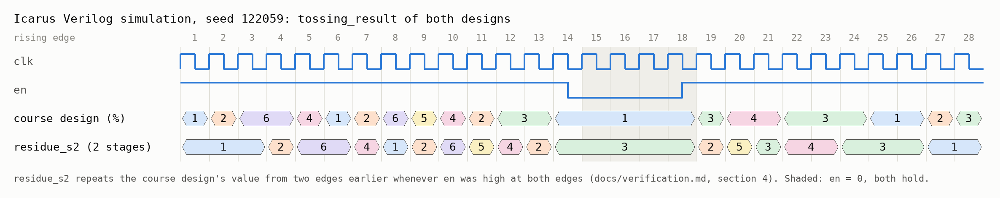
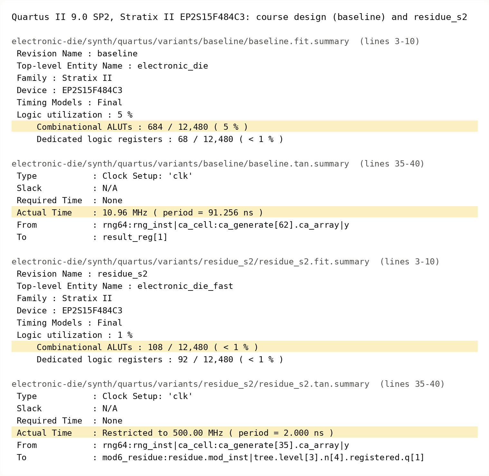
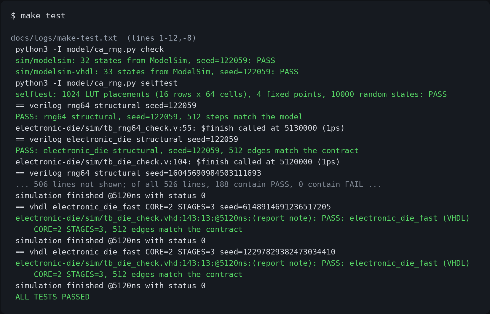
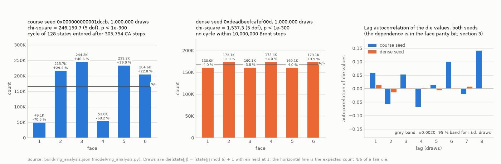

# 電子骰子：經過驗證、量測與管線化的 64 位元 CA 亂數產生器

[English](README.md) | **中文**

以一份課程作業為基礎的小型數位設計專案。64 格的細胞自動機（cellular
automaton，CA）每個時脈產生一個新的 64 位元狀態，骰子顯示
`(state mod 6) + 1`。這個 repo 在作業之外加上了：參考模型、Verilog 與 VHDL
的自我檢查 testbench、亂數產生器的統計分析，以及不用除法的 mod 6 電路，
把合成後的時脈頻率從 10.96 MHz 提高到這顆元件時脈腳位的上限 500 MHz。

## 起點

`electronic-die/rtl/{verilog,vhdl}` 與 `electronic-die/rtl/*-behavioral` 的
RTL、`electronic-die/sim/modelsim*` 的 ModelSim 腳本與輸出、
`electronic-die/synth/quartus/` 的原始 Quartus 專案，以及 `ram-controller/rtl/`
的 RAM 控制器，是國立臺灣師範大學 *Computer-Aided Design for VLSI Design*
（2026 年春季）的作業。這些檔案保持繳交時的樣子：原本的 Quartus 與 ModelSim
腳本指向課程當時的資料夾，是紀錄，不打算在這個目錄結構下重跑（重新編譯請用
`electronic-die/synth/quartus/variants/`）。電路邏輯沒有改動；只有種子和啟動碼
改成參數，RAM 控制器的實體名稱從 `hw3` 改成 `seq_rw_ram`（原始的 Quartus
摘要仍顯示 `hw3`）。

其餘都是之後加上的：

| 後加的內容 | 位置 |
|---|---|
| 重現原始 ModelSim 執行結果的 Python 參考模型 | `model/ca_rng.py` |
| 從 RTL 推導出、精確到每個時脈的時序規格 | `docs/verification.md` |
| 自我檢查的 testbench（Icarus Verilog、GHDL） | `electronic-die/sim/tb_*`、`ram-controller/sim/` |
| 變異測試（mutation testing）：故意改壞的 RTL 複本，測試必須判定它們失敗 | `tools/mutants.py`、`docs/logs/mutants.txt` |
| `make test` 與 CI workflow | `Makefile`、`.github/workflows/test.yml` |
| 亂數品質量測 | `model/rng_analysis.py`、`docs/rng_analysis.md` |
| 不用除法的 mod 6 電路與管線化的頂層（Verilog；residue 電路另有 VHDL 版） | `electronic-die/rtl/{verilog,vhdl}/mod6_*`、`electronic_die_fast.*` |
| Quartus 變體專案與自動產生的結果表 | `tools/quartus.py`、`electronic-die/synth/quartus/variants/`、`docs/results.md` |
| 推導與設計筆記（英文） | `docs/design-notes.md` |
| 本文件中的圖：一個產生波形的 testbench 與兩支畫圖程式（`make figures`） | `electronic-die/sim/tb_wave.v`（GTKWave 用 `tb_wave.gtkw`）、`tools/wave_png.py`、`tools/text_png.py`、`docs/img/` |

## 運作方式

```
            +----------------------+  64  +-----------------------+   3  +--------------+
  SEED ---->| 64-cell CA (rng64)   |----->| mod 6, then +1        |----->| result_reg   |---> tossing_result[2:0]
            | one 16-entry LUT per |      | course: % operator    |      | written when |
  clk  ---->| cell, steps every    |      | new: mod-3 residue    |      | en = 1       |
            | clock after the seed |      | tree, STAGES pipeline |      |              |
            +----------------------+      +-----------------------+      +--------------+
```

種子載入後，每一格每個時脈查一次自己的 16 格查表（LUT）；64 位元狀態經過
mod 6 再加 1，在 `en = 1` 時寫進 `result_reg`。課程版的 mod 6 用 `%` 運算子，
新版用 mod 3 餘數樹，可用 `STAGES` 參數設定管線級數。

第 i 格查表的位址是 `adr = {c[i], c[i-1], c[i+2], c[i+1]}`（索引取 mod 64）：

| adr  | 0000 | 0001 | 0010 | 0011 | 0100 | 0101 | 0110 | 0111 | 1000 | 1001 | 1010 | 1011 | 1100 | 1101 | 1110 | 1111 |
|------|---|---|---|---|---|---|---|---|---|---|---|---|---|---|---|---|
| 下一拍 | 0 | 1 | 1 | 0 | 0 | 0 | 0 | 1 | 1 | 1 | 1 | 0 | 0 | 1 | 0 | 1 |

mod 6 的部分用 `x mod 6 = b0 + 2 * ((x >> 1) mod 3)`；又因為 4 除以 3 餘 1，
`(x >> 1) mod 3` 等於把它每兩個位元切成一個 4 進位數字、全部相加再 mod 3。
於是 64 級的除法器換成一棵五層、由相同的四輸入節點組成的樹。推導、實例與
管線時序在 `docs/design-notes.md`（英文）。



*用 Icarus Verilog 執行 `electronic-die/sim/tb_wave.v`，由 `tools/wave_png.py`
從 VCD 傾印檔畫出。`en` 維持為 1 時，管線版骰子比課程設計晚兩個時脈顯示
同樣的值（testbench 在每個這樣的時脈邊緣都會檢查）；灰底的時脈 `en` 為 0，
兩個輸出都保持不變。執行 `make figures` 之後，可以用
`gtkwave build/wave/die_wave.vcd electronic-die/sim/tb_wave.gtkw`
在 GTKWave 打開同一份傾印檔。*

## 結果

Quartus II 9.0 SP2，Stratix II EP2S15F484C3，每一列的設定都相同。數字與
[英文 README](README.md) 的結果表相同；原表由 `tools/quartus.py collect` 從
repo 裡的 `*.summary` 檔產生，完整列表見 [docs/results.md](docs/results.md)
（英文）。

| 變體 | 管線級數 | ALUT（全部／mod 6） | 暫存器 | fmax（MHz） | 相對課程設計（同一種語言） |
|---|---:|---:|---:|---:|---:|
| 課程設計（`%` 運算子） | 0 | 684 / 618 | 68 | 10.96 | 1.0x |
| `%` 再加一級輸出暫存器 | 1 | 686 / 620 | 72 | 11.30 | 1.0x |
| `popcount_s0` | 0 | 202 / 130 | 72 | 75.95 | 6.9x |
| `popcount_s3` | 3 | 214 / 146 | 165 | 115.22 | 10.5x |
| `residue_s0` | 0 | 110 / 41 | 69 | 270.86 | 24.7x |
| `residue_s1` | 1 | 113 / 45 | 78 | 468.38 | 42.7x |
| `residue_s2` | 2 | 108 / 40 | 92 | 500.00（時脈腳位上限） | 45.6x |
| 課程設計，VHDL（`mod` 運算子） | 0 | 4359 / 4293 | 68 | 4.57 | 1.0x |
| `vhdl_residue_s2` | 2 | 109 / 40 | 93 | 493.34 | 108.0x |



*圖中文字原封不動取自課程設計與 `residue_s2` 的 Quartus 摘要（每段上方標有
檔名與行號），由 `tools/text_png.py` 畫出。「Restricted to 500.00 MHz」是
這顆元件時脈腳位的上限；最慢的暫存器到暫存器路徑只需要 2.000 ns 週期中的
1.829 ns（[docs/results.md](docs/results.md)）。*

## 執行方式

```
sudo apt install -y iverilog ghdl make python3      # Ubuntu；CI 用同樣的套件
make test                                           # 跑全部的自我檢查測試
```



*一次實際執行的前 12 行與最後 8 行，完整紀錄存在 `docs/logs/make-test.txt`
（家目錄縮寫成 `~`）；中間那一行統計整份紀錄裡 PASS 與 FAIL 的行數。*

沒有 root 權限時，可以把同樣的 Ubuntu 套件解壓到一個資料夾再使用（在 repo
根目錄執行；amd64 或其他 Debian 架構都可以）：

```
mkdir -p ~/.cache/eda-debs && cd ~/.cache/eda-debs
apt-get download iverilog ghdl-mcode ghdl-common make
for f in *.deb; do dpkg -x "$f" ~/.local/opt/eda; done
cd -  &&  ~/.local/opt/eda/usr/bin/make test EDA_HOME=$HOME/.local/opt/eda
```

| 目標 | 檢查內容 |
|---|---|
| `make test-model` | Python 模型能重現 repo 裡的兩份 ModelSim 輸出 |
| `make test-verilog`、`make test-vhdl` | 亂數產生器與骰子，structural 與 behavioural 兩種寫法，六個種子（課程種子、一個高密度種子、CA 的四個固定點），每個時脈都檢查 |
| `make test-ram` | RAM 控制器：連續寫入與讀取、錯誤的 ID、寫入優先、讀取延遲 |
| `make test-m3` | 兩種 mod 6 電路與 `%` 比對（16 位元的所有輸入、64 位元的隨機輸入），以及管線化的骰子，Verilog 與 VHDL |
| `make analysis` | 用參考模型重新產生 `docs/rng_analysis.md`（約 30 秒；圖表用 `model/plot_rng.py` 重畫） |
| `make test-mutants` | `tools/mutants.py` 裡的每個變異都必須讓對應的測試失敗（不在 `make test` 裡；要幾分鐘） |
| `make figures` | 重畫 `docs/img/` 裡的波形、測試執行與 Quartus 圖（需要 Pillow；會重跑 `make test` 取得圖中的紀錄） |

合成數字來自 Quartus II 9.0 SP2 Web Edition，也就是課程使用的版本（現行的
Quartus 已不支援 Stratix II）：

```
QUARTUS_BIN=<quartus_sh 所在的資料夾> tools/run_quartus.sh   # 在 Linux 上透過 Wine 執行
```

## 骰子有多隨機



*由 `model/plot_rng.py` 根據 `model/rng_analysis.py` 的輸出畫出；方法與所有
數字見 [docs/rng_analysis.md](docs/rng_analysis.md)（英文）。*

## 限制

- 這些設計都做過合成、配置與繞線（place and route）、時序分析；沒有一個在
  FPGA 板上實際跑過。
- fmax 來自沒有時序限制、使用預設設定的編譯（與課程當時的設定相同），而且
  只在一種元件上。
- 這個 CA 是硬體亂數產生器的教學範例，不是經過認證的亂數產生器，也不適合
  用在密碼學。`docs/rng_analysis.md` 列出量測了什麼與已知的弱點：四個固定點、
  偏向偶數點，以及課程種子本身在 305,754 個 CA 步驟之後掉進 128 個狀態的循環。
