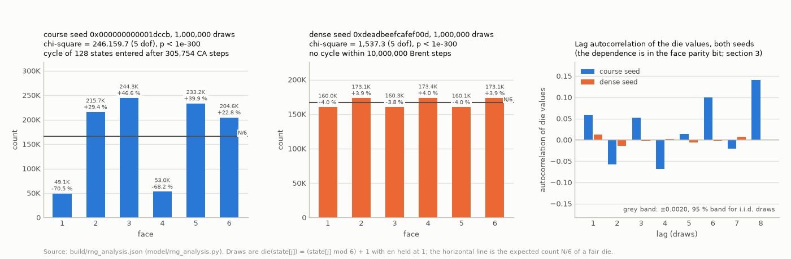

<!-- Generated by model/rng_analysis.py from build/rng_analysis.json. Do not edit by hand. -->
# RNG quality analysis: 64-bit cellular-automaton die

Generated 2026-10-13 21:13:37 UTC by `python3 -I model/rng_analysis.py --md docs/rng_analysis.md --json build/rng_analysis.json` in 27.9 s (Python 3.14.4, standard library only). Every number below is rendered from `build/rng_analysis.json`; rerun the command to regenerate both files. `build/` is git-ignored, so the JSON is not committed: the run is deterministic (the survey seeds come from `random.Random(20261014)`) and the command recreates it in the time listed in section 8.

## Summary

- **The course seed `122059` runs into a cycle of 128 states after 305,754 CA steps** (about 27.9 ms at the baseline 10.96 MHz; the die shows the first cycle value after clock edge 305,756). From then on the die repeats the same 128 values and shows only faces 2, 3, 5, 6.
- The dense seed `0xdeadbeefcafef00d` shows no cycle within 10,000,000 Brent steps: its first 4,194,305 states (state[0..4,194,304]) are pairwise distinct.
- **Even faces are favoured.** The parity of the face is cell 0 of the state, and the CA settles at a density of ones of about 0.519 rather than 0.5, so P(even face) = 0.5196 for the dense seed over 1,000,000 draws (chi-square 1,537.3 on 5 dof, p < 1e-300). Within each parity the three faces are consistent with uniform (p = 0.8722 and 0.8409).
- **Consecutive faces are not independent.** P(even | previous even) = 0.5890 against P(even | previous odd) = 0.4445 (dense seed), because a cell's next value is 1 in 5 of the 8 LUT rows with cell[i] = 1 but only in 3 of the 8 rows with cell[i] = 0. The 6x6 independence test rejects (p < 1e-300); the mod-3 residues show no detectable dependence (p = 0.9979).
- The CA has exactly 4 fixed points and no other cycle of length up to 5 (exhaustive); none of 2,000 random seeds and 64 single-bit seeds has a cycle with mu + lambda <= 4,096 (Brent capped at 10,000 hare steps finds every such cycle).

## 1. Method

**The generator.** `rng64` is a one-dimensional cellular automaton (CA) of 64 cells on a ring (`electronic-die/rtl/*/rng64.*`, `ca_cell.*`). On every rising clock edge with `sel = 1` each cell `i` reads the 4-bit address `adr = {cell[i], cell[i-1], cell[i+2], cell[i+1]} (indices mod 64)` and takes its next value from the lookup table below; with `sel = 0` it loads its seed bit. The table is balanced (8 ones out of 16 entries) but not self-neutral: among the rows with `cell[i] = 1` the next value is 1 in 5 of 8 cases, among the rows with `cell[i] = 0` in 3 of 8.

| adr | next | adr  | next  |
|---|---|---|---|
| 0000 | 0 | 1000 | 1 |
| 0001 | 1 | 1001 | 1 |
| 0010 | 1 | 1010 | 1 |
| 0011 | 0 | 1011 | 0 |
| 0100 | 0 | 1100 | 0 |
| 0101 | 0 | 1101 | 1 |
| 0110 | 0 | 1110 | 0 |
| 0111 | 1 | 1111 | 1 |

**The draws.** The die value is `die(x) = (x mod 6) + 1` of the whole 64-bit state. Under the timing contract of `electronic_die` (docs/verification.md, section 2) the output register is written at every rising edge `m >= 2` at which `en = 1`, with `die(state[m-2])` (edge 1 only loads the seed). *`en` held at 1* therefore means that the output shows every CA state exactly once, in order: a run of N+1 clocks yields the N draws `die(state[0]), ..., die(state[N-1])`, where `state[0]` is the seed and draw `j` appears after edge `j+2`. Counts of steps below are state indices: the CA holds `state[j]` after edge `j+1`. Any other `en` pattern only selects a subsequence of this same deterministic sequence, because the CA free-runs regardless of `en`. All draws here are taken that way, with the states produced by the reference model `model/ca_rng.py` (`ca_step_fast`, checked against the bit-by-bit `ca_step` by `python3 -I model/ca_rng.py selftest`). Because `x mod 2` is cell 0, the face is even exactly when cell 0 is 1; `x mod 3` depends on every cell (2^k mod 3 alternates 1, 2).

**Seeds.** `122059` (`0x000000000001dccb`, the course run and the default `SEED` parameter) and `0xdeadbeefcafef00d` (the dense seed also used by `make test`). Each seed gets the period search and the full set of statistics over 1,000,000 draws; when the period search finds a cycle inside that window, the draws before the cycle are also analysed on their own.

**Statistics.** The null hypothesis throughout is *independent, uniformly distributed faces*. Chi-square p-values are computed in pure Python as the regularised upper incomplete gamma function `Q(dof/2, chi2/2)`: `Q(1/2, y) = erfc(sqrt(y))`, `Q(1, y) = exp(-y)`, then `Q(a+1, y) = Q(a, y) + y^a e^-y / Gamma(a+1)` (`chi2_sf` in `model/rng_analysis.py`); values below 1e-300 are printed as such. The independence test is the contingency chi-square on the 6x6 matrix of overlapping consecutive pairs, i.e. the Anderson-Goodman test of a zero-order against a first-order Markov chain, with (6-1)^2 = 25 degrees of freedom; the same test is applied to the face parity (2x2, 1 dof) and to `x mod 3` (3x3, 4 dof). Autocorrelation at lag L is `r_L = sum_j (x_j - m)(x_{j+L} - m) / sum_j (x_j - m)^2` with `m` the sample mean; for i.i.d. draws `r_L` has standard error `1/sqrt(N)`. The period search is Brent's cycle-finding algorithm on the state sequence; with the tortoise parked at positions `2^k - 1`, a run of `cap` hare steps without a match proves that `state[0..2^j]` are pairwise distinct for the largest `j` with `2^(j+1) - 1 <= cap` (every cycle with `mu + lambda <= 2^j` would have been found by hare step `2^j - 1 + lambda <= 2^(j+1) - 1`). Every step of a found cycle is re-verified with both `ca_step` and `ca_step_fast` (`cycle_profile`).

A 64-bit word folded by `mod 6` is not perfectly uniform: `2^64 mod 6 = 4`, so faces 1-4 have one more preimage than faces 5-6; the relative bias is `6 / 2^64 = 3.25e-19` and is invisible at any sample size used here.

## 2. Uniformity of the six faces

Seed `0x000000000001dccb` (course), 1,000,000 consecutive draws, expected 166,666.7 per face; 305,754 of these draws precede the cycle and 694,246 repeat its 128 values:

| face | count | deviation from expected |
|---|---|---|
| 1 | 49,143 | -70.514 % |
| 2 | 215,706 | +29.424 % |
| 3 | 244,349 | +46.609 % |
| 4 | 53,031 | -68.181 % |
| 5 | 233,181 | +39.909 % |
| 6 | 204,590 | +22.754 % |

chi-square = 246,159.683 with 5 degrees of freedom, p < 1e-300: uniformity rejected at the 0.1 % level.

The same seed, only the 305,754 draws before the cycle (expected 50,959.0 per face):

| face | count | deviation from expected |
|---|---|---|
| 1 | 49,143 | -3.564 % |
| 2 | 52,992 | +3.989 % |
| 3 | 49,089 | -3.670 % |
| 4 | 53,031 | +4.066 % |
| 5 | 48,772 | -4.292 % |
| 6 | 52,727 | +3.469 % |

chi-square = 453.891 with 5 degrees of freedom, p = 7.11e-96: uniformity rejected at the 0.1 % level.

Seed `0xdeadbeefcafef00d` (dense), 1,000,000 consecutive draws, expected 166,666.7 per face:

| face | count | deviation from expected |
|---|---|---|
| 1 | 160,031 | -3.981 % |
| 2 | 173,097 | +3.858 % |
| 3 | 160,303 | -3.818 % |
| 4 | 173,400 | +4.040 % |
| 5 | 160,066 | -3.960 % |
| 6 | 173,103 | +3.862 % |

chi-square = 1,537.263 with 5 degrees of freedom, p < 1e-300: uniformity rejected at the 0.1 % level.

Parity decomposition. The face is even exactly when cell 0 of the state is 1, so the even-face count equals the number of states with cell 0 set (checked). The six-face chi-square splits (approximately, for Pearson's statistic) into the parity (1 dof), the three odd faces given odd (2 dof) and the three even faces given even (2 dof); `x mod 3` (2 dof) is listed as well:

| sequence | P(even face) | parity chi2 / p (1 dof) | odd faces chi2 / p (2 dof) | even faces chi2 / p (2 dof) | x mod 3 chi2 / p (2 dof) |
|---|---|---|---|---|---|
| course seed, 1,000,000 draws | 0.47333 | 2,845.8 / < 1e-300 | 136,897.26 / < 1e-300 | 104,698.97 / < 1e-300 | 240,455.87 / < 1e-300 |
| course seed, 305,754 draws before the cycle | 0.51921 | 451.2 / 3.87e-100 | 1.64 / 0.4405 | 1.03 / 0.5963 | 0.98 / 0.6133 |
| dense seed, 1,000,000 draws | 0.51960 | 1,536.6 / < 1e-300 | 0.27 / 0.8722 | 0.35 / 0.8409 | 0.13 / 0.9364 |

Figure: `uv run --with matplotlib python3 model/plot_rng.py build/rng_analysis.json docs/img/die_histogram.png` (matplotlib, not part of the standard-library path).

## 3. Independence of consecutive draws

Transition counts `from` (row) -> `to` (column), seed `0x000000000001dccb` (course), 999,999 consecutive pairs (about 27,778 per cell if independent):

| from \ to | 1 | 2 | 3 | 4 | 5 | 6 | row sum |
|---|---|---|---|---|---|---|---|
| 1 | 9,242 | 7,210 | 9,236 | 7,204 | 8,891 | 7,360 | 49,143 |
| 2 | 7,358 | 53,850 | 61,488 | 10,434 | 34,458 | 48,118 | 215,706 |
| 3 | 8,930 | 34,415 | 79,540 | 7,361 | 74,141 | 39,962 | 244,349 |
| 4 | 7,376 | 10,437 | 7,247 | 10,420 | 7,290 | 10,261 | 53,031 |
| 5 | 8,979 | 56,097 | 57,970 | 7,166 | 63,246 | 39,723 | 233,181 |
| 6 | 7,258 | 53,696 | 28,868 | 10,446 | 45,155 | 59,166 | 204,589 |

Transition counts `from` (row) -> `to` (column), seed `0xdeadbeefcafef00d` (dense), 999,999 consecutive pairs (about 27,778 per cell if independent):

| from \ to | 1 | 2 | 3 | 4 | 5 | 6 | row sum |
|---|---|---|---|---|---|---|---|
| 1 | 29,358 | 23,894 | 29,715 | 23,684 | 29,712 | 23,668 | 160,031 |
| 2 | 23,832 | 33,833 | 23,887 | 34,030 | 23,525 | 33,990 | 173,097 |
| 3 | 29,718 | 23,746 | 29,751 | 23,706 | 29,544 | 23,838 | 160,303 |
| 4 | 23,834 | 33,902 | 23,801 | 34,237 | 23,612 | 34,014 | 173,400 |
| 5 | 29,589 | 23,713 | 29,588 | 23,686 | 29,866 | 23,623 | 160,065 |
| 6 | 23,700 | 34,009 | 23,561 | 34,056 | 23,807 | 33,970 | 173,103 |

| sequence | 6x6 chi2 / p (25 dof) | P(even | prev even) | P(even | prev odd) | parity phi | mod-3 3x3 chi2 / p (4 dof) |
|---|---|---|---|---|---|
| course seed, 1,000,000 draws | 122,110.9 / < 1e-300 | 0.5637 | 0.3921 | +0.1716 | 67,326.53 / < 1e-300 |
| course seed, 305,754 draws before the cycle | 6,207.9 / < 1e-300 | 0.5875 | 0.4454 | +0.1421 | 3.86 / 0.4260 |
| dense seed, 1,000,000 draws | 20,881.7 / < 1e-300 | 0.5890 | 0.4445 | +0.1445 | 0.13 / 0.9979 |

Lag autocorrelation of the die-value sequence (centred, normalised), with the 95 % band +/-1.96/sqrt(N) for independent draws, followed by the autocorrelation of the face parity (1 = even face) at the same lags:

| lag | course seed, 1,000,000 draws | course seed, 305,754 draws before the cycle | dense seed, 1,000,000 draws |
|---|---|---|---|
| 1 | +0.05815 | +0.01404 | +0.01256 |
| 2 | -0.05766 | -0.01541 | -0.01452 |
| 3 | +0.05261 | -0.00195 | -0.00238 |
| 4 | -0.06844 | +0.00222 | +0.00216 |
| 5 | +0.01357 | -0.00489 | -0.00549 |
| 6 | +0.09920 | -0.00154 | -0.00257 |
| 7 | -0.02126 | +0.00427 | +0.00682 |
| 8 | +0.14048 | +0.00177 | +0.00065 |
| 95 % band | +/-0.00196 | +/-0.00354 | +/-0.00196 |
| parity, lag 1 | +0.17165 | +0.14211 | +0.14445 |
| parity, lag 2 | -0.01420 | -0.18068 | -0.17734 |
| parity, lag 3 | -0.18261 | -0.02007 | -0.02117 |
| parity, lag 4 | -0.12706 | +0.01926 | +0.01534 |
| parity, lag 5 | -0.23884 | -0.06161 | -0.06278 |
| parity, lag 6 | -0.14009 | -0.02334 | -0.02242 |
| parity, lag 7 | +0.01591 | +0.05980 | +0.05907 |
| parity, lag 8 | +0.11035 | +0.01297 | +0.01148 |
| mean (ideal 3.5) | 3.8192 | 3.5150 | 3.5197 |
| variance (ideal 2.9167) | 2.5683 | 2.9145 | 2.9147 |

## 4. Period

| seed | cap (hare steps) | Brent result | established | distinct states in the draw window (set check) |
|---|---|---|---|---|
| `0x000000000001dccb` | 10,000,000 | cycle found: tail mu = 305,754, cycle length lambda = 128 | period 128 after 305,754 CA steps | 305,882 of 1,000,000 |
| `0xdeadbeefcafef00d` | 10,000,000 | no cycle within 10,000,000 hare steps | state[0..4,194,304] pairwise distinct (mu + lambda > 4,194,304) | 1,000,000 of 1,000,000 (all distinct) |

The cycle of seed `0x000000000001dccb` is entered at `0x95085dce47239c9c` = state[305,754], i.e. after 305,754 CA steps: the CA holds it after clock edge 305,755 and the die shows its value after edge 305,756 (about 27.9 ms at 10.96 MHz, the baseline fmax). It is a travelling pattern: state[j+4] = state[j] rotated right by 2 cell(s), so the pattern returns to itself after 128 steps. Its states hold 27-31 ones (mean 29.0 of 64). The die values along one period are `53352362233556625335236223355365266553325662533523622335563226355365266553352362233523352332266553325662533556322635266226655665`; face counts per period 1: 0, 2: 30, 3: 36, 4: 0, 5: 34, 6: 28; faces 1, 4 never occur.

The state space has 2^64 states, so the true period of any orbit is below 2^64; only what the table states has been established.

## 5. Per-cell bit balance

| sequence | min | max | mean over cells | sd over cells | fair-coin sd | cells beyond 3 sd | ones in the whole state |
|---|---|---|---|---|---|---|---|
| course seed, 1,000,000 draws | 0.47278 (cell 13) | 0.47397 (cell 49) | 0.47334 | 0.00026 | 0.00050 | 64 | 0.47334 |
| course seed, 305,754 draws before the cycle | 0.51739 (cell 13) | 0.52129 (cell 49) | 0.51923 | 0.00084 | 0.00090 | 64 | 0.51923 |
| dense seed, 1,000,000 draws | 0.51806 (cell 24) | 0.52034 (cell 18) | 0.51923 | 0.00050 | 0.00050 | 64 | 0.51923 |

Fraction of ones in each of the 64 cells, seed `0x000000000001dccb` (course), 1,000,000 states:

|  | +0 | +1 | +2 | +3 | +4 | +5 | +6 | +7 |
|---|---|---|---|---|---|---|---|---|
| cells 0-7 | 0.4733 | 0.4732 | 0.4730 | 0.4735 | 0.4738 | 0.4731 | 0.4731 | 0.4736 |
| cells 8-15 | 0.4735 | 0.4732 | 0.4732 | 0.4734 | 0.4734 | 0.4728 | 0.4734 | 0.4737 |
| cells 16-23 | 0.4728 | 0.4733 | 0.4733 | 0.4738 | 0.4734 | 0.4732 | 0.4732 | 0.4733 |
| cells 24-31 | 0.4733 | 0.4736 | 0.4736 | 0.4729 | 0.4733 | 0.4733 | 0.4736 | 0.4730 |
| cells 32-39 | 0.4737 | 0.4731 | 0.4730 | 0.4734 | 0.4733 | 0.4734 | 0.4731 | 0.4733 |
| cells 40-47 | 0.4737 | 0.4734 | 0.4731 | 0.4736 | 0.4730 | 0.4735 | 0.4733 | 0.4731 |
| cells 48-55 | 0.4737 | 0.4740 | 0.4729 | 0.4735 | 0.4733 | 0.4733 | 0.4735 | 0.4729 |
| cells 56-63 | 0.4734 | 0.4734 | 0.4730 | 0.4736 | 0.4735 | 0.4735 | 0.4736 | 0.4735 |

Worst cells (largest |fraction - 0.5|, z in fair-coin standard deviations): cell 13 = 0.47278 (z = -54.4), cell 16 = 0.47280 (z = -54.4), cell 27 = 0.47288 (z = -54.2), cell 55 = 0.47289 (z = -54.2), cell 50 = 0.47292 (z = -54.2).

Fraction of ones in each of the 64 cells, seed `0xdeadbeefcafef00d` (dense), 1,000,000 states:

|  | +0 | +1 | +2 | +3 | +4 | +5 | +6 | +7 |
|---|---|---|---|---|---|---|---|---|
| cells 0-7 | 0.5196 | 0.5189 | 0.5192 | 0.5200 | 0.5186 | 0.5196 | 0.5194 | 0.5189 |
| cells 8-15 | 0.5200 | 0.5193 | 0.5187 | 0.5194 | 0.5193 | 0.5189 | 0.5188 | 0.5184 |
| cells 16-23 | 0.5198 | 0.5185 | 0.5203 | 0.5194 | 0.5184 | 0.5190 | 0.5202 | 0.5201 |
| cells 24-31 | 0.5181 | 0.5193 | 0.5185 | 0.5190 | 0.5196 | 0.5190 | 0.5193 | 0.5190 |
| cells 32-39 | 0.5199 | 0.5187 | 0.5188 | 0.5189 | 0.5196 | 0.5193 | 0.5195 | 0.5196 |
| cells 40-47 | 0.5191 | 0.5194 | 0.5189 | 0.5200 | 0.5186 | 0.5195 | 0.5188 | 0.5192 |
| cells 48-55 | 0.5197 | 0.5196 | 0.5190 | 0.5191 | 0.5184 | 0.5198 | 0.5191 | 0.5201 |
| cells 56-63 | 0.5185 | 0.5194 | 0.5191 | 0.5196 | 0.5192 | 0.5191 | 0.5191 | 0.5195 |

Worst cells (largest |fraction - 0.5|, z in fair-coin standard deviations): cell 18 = 0.52034 (z = +40.7), cell 22 = 0.52023 (z = +40.5), cell 23 = 0.52010 (z = +40.2), cell 55 = 0.52005 (z = +40.1), cell 3 = 0.52001 (z = +40.0).

## 6. Fixed points and short cycles

`LUT[0000] = 0` and `LUT[1111] = 1`, so the all-zero and all-one states map to themselves; `LUT[0101] = 0` and `LUT[1010] = 1` do the same for the two alternating patterns, in which every cell sees `{cell[i], cell[i-1], cell[i+2], cell[i+1]}` = its own value, its complement, its own value, its complement. Checked with both `ca_step` and `ca_step_fast`:

| state | fixed point | die value |
|---|---|---|
| all-zero `0x0000000000000000` | yes | 1 |
| all-one `0xffffffffffffffff` | yes | 4 |
| alternating 0101 `0x5555555555555555` | yes | 6 |
| alternating 1010 `0xaaaaaaaaaaaaaaaa` | yes | 5 |

Exhaustive census of short orbits (transfer-matrix count of the states `x` with `f^p(x) = x`; a state of minimal period `q` is counted for every `p` that `q` divides):

| p | window / graph size | states with f^p(x) = x | states |
|---|---|---|---|
| 1 | 4 cells / 8 window states | 4 | `0x0000000000000000` (period 1, die 1), `0x5555555555555555` (period 1, die 6), `0xaaaaaaaaaaaaaaaa` (period 1, die 5), `0xffffffffffffffff` (period 1, die 4) |
| 2 | 7 cells / 64 window states | 4 | `0x0000000000000000` (period 1, die 1), `0x5555555555555555` (period 1, die 6), `0xaaaaaaaaaaaaaaaa` (period 1, die 5), `0xffffffffffffffff` (period 1, die 4) |
| 3 | 10 cells / 512 window states | 4 | `0x0000000000000000` (period 1, die 1), `0x5555555555555555` (period 1, die 6), `0xaaaaaaaaaaaaaaaa` (period 1, die 5), `0xffffffffffffffff` (period 1, die 4) |
| 4 | 13 cells / 4,096 window states | 4 | `0x0000000000000000` (period 1, die 1), `0x5555555555555555` (period 1, die 6), `0xaaaaaaaaaaaaaaaa` (period 1, die 5), `0xffffffffffffffff` (period 1, die 4) |
| 5 | 16 cells / 32,768 window states | 4 | `0x0000000000000000` (period 1, die 1), `0x5555555555555555` (period 1, die 6), `0xaaaaaaaaaaaaaaaa` (period 1, die 5), `0xffffffffffffffff` (period 1, die 4) |

The CA has exactly 4 fixed points (`0x0000000000000000`, `0x5555555555555555`, `0xaaaaaaaaaaaaaaaa`, `0xffffffffffffffff`) and no cycles of length 2 to 5. The alternating patterns are fixed because `LUT[0101] = 0` and `LUT[1010] = 1`.

Survey: 2,000 random seeds (`random.Random(20261014)`) and the 64 single-bit seeds, each run with Brent capped at 10,000 hare steps (a seed that finds no cycle has `mu + lambda > 4,096`):

| seeds | n | cycle found | no cycle | cycle lengths | fixed points reached | tail mu |
|---|---|---|---|---|---|---|
| random | 2000 | 0 | 2000 | - | - | - |
| single-bit | 64 | 0 | 64 | - | - | - |

The 64 single-bit seeds are rotations of one another and the rule is the same at every cell, so they form one rotation class; their results are identical.

## 7. Known weaknesses

1. **The shipped seed has a period of 128.** With the default `SEED = 122059` the CA enters a 128-state cycle after 305,754 CA steps (about 27.9 ms at 10.96 MHz). After that the die is a fixed loop of 128 values that never shows faces 1, 4; over the 1,000,000-draw window the faces are far from uniform (chi-square 246,160 on 5 dof). The 305,754 draws before the cycle behave like the dense seed below. The course testbenches only cover the first few hundred clocks and cannot see this; the fix is a seed with a verified long orbit (or a different rule).
2. **Even faces are favoured by about 2.0 percentage points.** The face parity is cell 0 of the state, and the rule drives the density of ones to about 0.519 in every cell (64 of the 64 cells of the dense seed lie beyond 3 fair-coin standard deviations), so P(even face) = 0.5196 and the six-face chi-square rejects uniformity (p < 1e-300) although the three faces within each parity are consistent with uniform (p = 0.8722 and 0.8409). Folding the word before the mod 6 (for example XOR of the two 32-bit halves) would make the face parity depend on several cells instead of cell 0 alone; that is a design change outside this measurement and is not implemented or tested here.
3. **Consecutive faces are dependent through their parity.** Under the rule a cell keeps its current value in 5 of the 8 LUT rows when it is 1 and in 5 of the 8 rows when it is 0 (probability 0.625 for a uniformly random neighbourhood), so the parity of consecutive draws is correlated: for the dense seed P(even | previous even) = 0.5890, P(even | previous odd) = 0.4445, phi = +0.1445, and the 6x6 independence test rejects (chi-square 20,882 on 25 dof). The `x mod 3` residues of consecutive draws show no detectable dependence (p = 0.9979), and the linear lag-1 autocorrelation of the face values is only +0.0126, because the dependence sits in the parity bit rather than in the magnitude. The parity autocorrelation is +0.1445 at lag 1, -0.1773 at lag 2 and still up to 0.0628 in magnitude at lags 3-8, so thinning the draws with `en` does not remove the dependence.
4. **4 stuck seeds.** The states `0x0000000000000000` (die 1), `0x5555555555555555` (die 6), `0xaaaaaaaaaaaaaaaa` (die 5), `0xffffffffffffffff` (die 4) are fixed points, so a die built with one of them as `SEED` (or an un-loaded, all-zero seed register) shows the same face forever. The exhaustive census finds no other cycle of length up to 5, and in the survey 0 of the 2,000 random seeds and 0 of the 64 single-bit seeds have a cycle with mu + lambda <= 4,096 (the bound that Brent capped at 10,000 hare steps certifies; longer tails or cycles are not excluded), so as far as this survey can tell the fixed points are reached only by seeding them directly.
5. **Fully deterministic and predictable.** The sequence depends only on the compile-time `SEED`; it is identical after every power-up, and `en` only chooses which positions of that one sequence are shown. The whole state is visible as 64 bits of the design and the rule is public, so the next face is computable from the current state: the generator is a pseudo-random pattern generator, not a source of entropy and not a cryptographic generator.
6. **Periods are known only for the seeds tested.** The dense seed is certified repeat-free for 4,194,305 states but its period is not known; the course seed shows that an innocent-looking seed can collapse after a few hundred thousand steps, and no bound applies to seeds that were not tested.
7. **What the tests do not show.** With 1,000,000 draws a face bias below about 0.1 % of the expected count is not detectable, the statistics measure only first-order uniformity and first-order dependence (plus lags up to 8), and no battery such as TestU01 or Dieharder was run.

## 8. Commands and run time

| purpose | command |
|---|---|
| full analysis (this file) | `python3 -I model/rng_analysis.py --md docs/rng_analysis.md --json build/rng_analysis.json` |
| smoke run, sample sizes / 100 | `python3 -I model/rng_analysis.py --md build/rng_analysis_quick.md --json build/rng_analysis_quick.json --quick` |
| re-render the markdown from the JSON | `python3 -I model/rng_analysis.py --md docs/rng_analysis.md --json build/rng_analysis.json --render-only` |
| check ca_step_fast against ca_step | `python3 -I model/ca_rng.py selftest` |
| figure | `uv run --with matplotlib python3 model/plot_rng.py build/rng_analysis.json docs/img/die_histogram.png` |

| phase | seconds |
|---|---|
| period course | 0.8 |
| window course | 1.8 |
| tail course | 0.6 |
| period dense | 7.2 |
| window dense | 2.0 |
| survey | 14.8 |
| census | 0.7 |
| total | 27.9 |

Parameters of this run: draws = 1,000,000, period_cap = 10,000,000, survey_seeds = 2,000, survey_cap = 10,000, census_max_period = 5; baseline fmax 10.96 MHz from `electronic-die/synth/quartus/electronic_die.tan.summary`.
